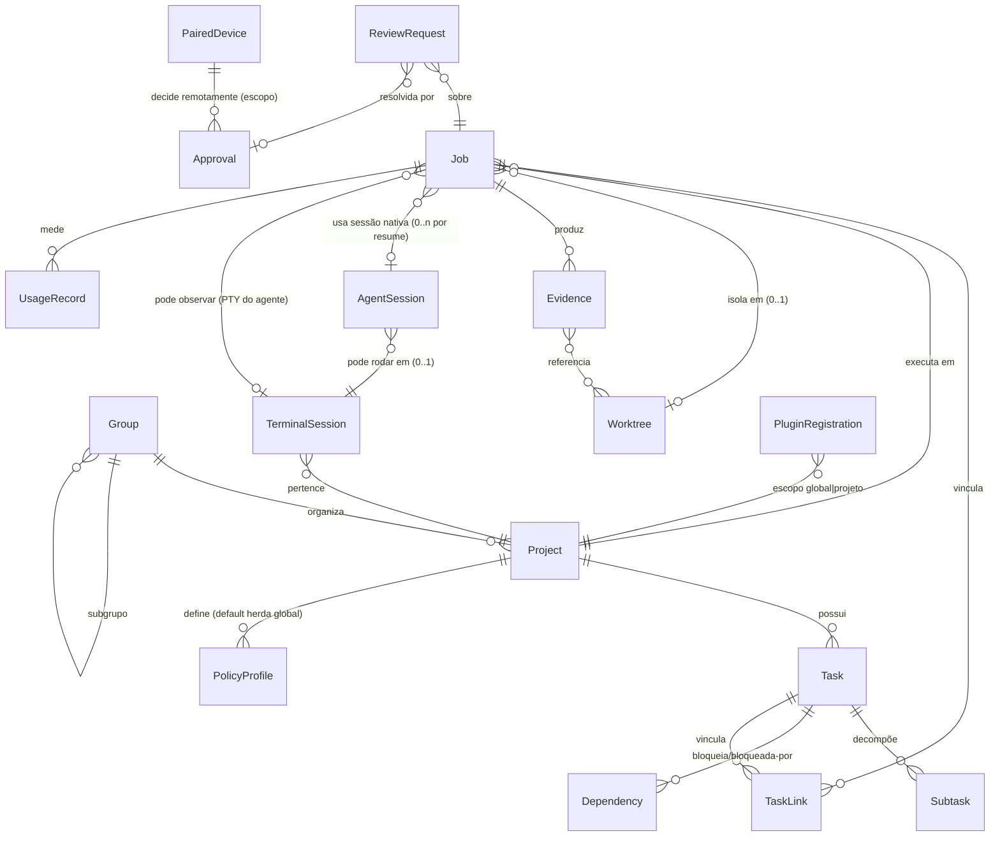
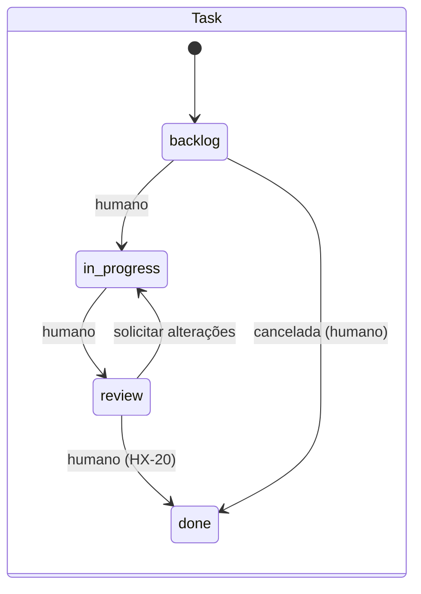
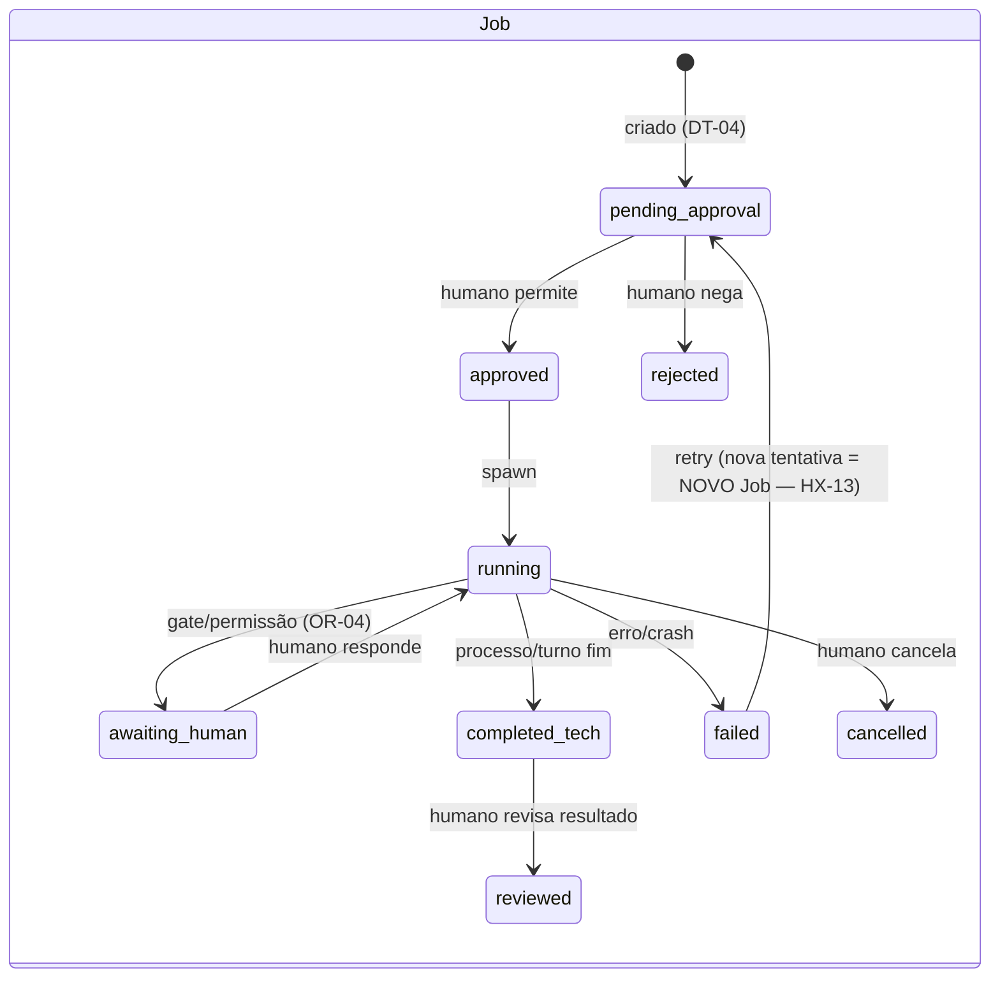

# Modelo de dados conceitual do HATI — PROPOSTA

> **Status: PROPOSTA (Prompt 03).** Modelo conceitual — **não é schema físico**. Toda
> alteração de status/DT/prioridade da matriz continua sendo decisão humana. ADR-003
> (persistência) sustenta este documento; Q6 do TECHNICAL_STUDY o justifica.

- **Data:** 15/10/2026 · **Autora:** Athena · **Princípios:** tarefa ≠ job; vínculos n-n;
  **não equiparar** fim de processo ≠ sucesso técnico ≠ critérios de aceite ≠ aprovação
  humana ≠ commit Git (CROSS_REVIEW).

## 1. Entidades e responsabilidades

| Entidade | Responsabilidade única | IDs |
|---|---|---|
| **Project** | Projeto registrado por pasta local; identidade por id estável; path atual + paths anteriores (HX-02: reconexão de pastas movidas) | WS-01, HX-01/02/03 |
| **Group** | Organização hierárquica (subgrupos) independente do diretório | WS-02 |
| **Task** | O trabalho a fazer; fonte única = Kanban; título/descrição/aceite/etiquetas/prioridade/checklist | HX-06/07 |
| **Subtask** | Decomposição de tarefa (self-link) | HX-08 |
| **Dependency** | Bloqueio entre tarefas (dirigida, sem ciclos) | HX-08 |
| **TaskLink** | Vínculo n-n tarefa↔(job, sessão, terminal, worktree, PR, evidência) | HX-13, GT-07 |
| **Job** | **Uma tentativa de execução** de uma tarefa (ou trabalho avulso) por agente/perfil; contém escopo, permissões, worktree opcional | HX-13/16, OR-* |
| **TerminalSession** | PTY vivo/histórico (shell ou CLI interativa); scrollback em arquivo próprio | TM-01..26 |
| **AgentSession** | Sessão **nativa** da CLI (id do provedor: thread/session id), referenciada — nunca recriada | AG-04/05 |
| **Worktree** | Worktree git provisionada por job/tarefa; ciclo de vida com revisão antes de remover | GT-05, OR-03 |
| **Evidence** | Artefato verificável de um job (diff, log de teste, métrica, arquivo) com **fonte, data, agente e nível de confiabilidade**; texto de agente não é prova | HX-17, OR-05 |
| **ReviewRequest** | Pedido de decisão humana (aprovação de job, gate de permissão, resultado de job) | HX-19/20, OR-04 |
| **Approval** | Decisão humana auditável (autor, ação, projeto, job, arquivos, instante); sem segredos | HX-23 |
| **PairedDevice** | Dispositivo pareado (nome, escopos RC-03, expiração, último uso, estado revogável) | RC-06, DT-09 |
| **UsageRecord** | Medição de consumo (tokens/custo/origem: verificada|estimada|indisponível) por sessão/job/projeto | US-04/05, OR-06 |
| **PolicyProfile** | Perfil de execução (HX-05): agente default, modelo, permissões, sandbox, gates | HX-05/21 |
| **PluginRegistration** | Plugin instalado/estado/capacidades/storage quota | PL-01..08 |

## 2. Diagrama de relacionamentos (n-n por tabelas de link)

**Regras de integridade (invariantes testáveis):**

1. Nenhum `Job` executa sem `Approval` registrado para o **exato** job/escopo (DT-04).
2. `Task.status = done` **exige** decisão humana; fim de `Job` nunca altera `Task.status`
   automaticamente (HX-10) — apenas sugere via evento.
3. `Dependency` acíclica (HX-08).
4. `Evidence` sem fonte/data/confiabilidade é rejeitada (HX-17).
5. `AgentSession` guarda o **id do provedor** + provider + versão testada; o HATI nunca
   escreve nos históricos nativos (AG-05: ler sem migrar/sobrescrever).
6. `TerminalSession` ↔ scrollback 1-1 em arquivo (fora do banco); `attach` devolve tail
   UTF-8 íntegro (TM-03/04).
7. `Approval`/`EventEnvelope` nunca contêm segredos (HX-23) — sanitização no emissor.
8. `Worktree` só é removida com revisão de pendências (GT-05).

## 3. Máquinas de estado (proposta)

- **TerminalSession:** `running → paused_read (TM-14) → running → suspended (WS-20) → running
  | exited(clean|killed|failed — TM-17)`; restart preserva id (TM-07).
- **Worktree:** `provisioned → active → pending_review → merged_externamente | archived`
  (remoção exige revisão — GT-05).
- **PairedDevice:** `paired → expired | revoked` (RC-06).
- `completed_tech` **≠** tarefa aprovada: o resultado vira `Evidence` + `ReviewRequest`
  na fila unificada (HX-19); o cartão mostra "aguardando revisão".

## 4. Exemplo concreto de não-1:1 (caso extremo do CROSS_REVIEW)

Tarefa T com 3 tentativas: Job J1 (Claude, PTY, sessão nativa S1, falhou) → Job J2 (Codex
app-server, worktree W1, retomou **a mesma** conversa por resume em nova AgentSession S2)
→ Job J3 (OpenCode server, reutilizou TerminalSession de J1 ainda aberta e W1). Duas
sessões, um worktree, três jobs, **zero** automação de status da tarefa — a decisão de
"T1 pronta" é sempre humana. Este cenário é caso de teste obrigatório (VALIDATION_PLAN).

## 5. Streams de eventos (Q4) sobre este modelo

- `project.*`, `task.*` (criada/movida/atualizada — **mover ≠ executar**), `job.*`
  (state, progresso por evento real do provedor — HX-15), `terminal.*` (exit/crash/
  suspend — TM-25), `evidence.*`, `approval.*` (HX-23), `usage.*` (frescor/erros — US-06),
  `device.*`, `policy.*`.
- Cada evento: `schema_version` + `correlation_id` (job) + sanitização. Byte-stream de PTY
  **não** é evento de domínio — vai para scrollback/lotes de render.

## 6. Persistência física proposta (ADR-003)

| Dado | Onde | Notas |
|---|---|---|
| Entidades §1 + eventos + links | `~/.local/share/hati/hati.db` (SQLite WAL, rusqlite) | Migrations versionadas no boot; daemon = único escritor; backups online + export zip (AX-20) |
| Scrollback | `~/.local/share/hati/scrollback/<pty>.bin` | Append incremental, cap configurável, compactação (TM-03) |
| Preferências/temas | `~/.config/hati/*.json` | Versionado, atômico (tmp+rename), legível |
| Segredos | **Keyring do OS** (Secret Service) | Nunca no banco/eventos/backups (R4, MC-05) |
| Logs/diagnósticos | `~/.local/state/hati/` (journal + spawn.log) | Sanitizados (AX-25) |
| Nada do HATI em repositórios de projetos | — (DT-07) | A escrita de `AGENTS.md`/`CLAUDE.md` em repo alheio é **opt-in explícito** (WS-13) |

## 7. Retenção e privacidade (proposta inicial — ajustável por humano)

- Eventos de domínio: retidos (história auditável — HX-12) com export seletivo.
- Scrollback: cap por sessão (configurável, default da auditoria como referência 4MB) +
  proteção contra dados sensíveis (aviso na UI; redação de segredos conhecidos no attach é
  **best-effort declarado**, não garantia — TM-03).
- Usage: local, sem telemetria externa (AX-26); exclusão seletiva por projeto (AX-20).
- Audit de approvals: permanente por perfil (HX-23), sem conteúdo secreto.

**Aprovação humana necessária:** este modelo conceitual inteiro (revisão antes do schema
físico) + ADR-003. Mudanças posteriores por ADR, conforme `docs/decisions/README.md`.
