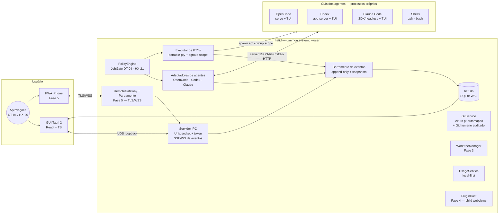
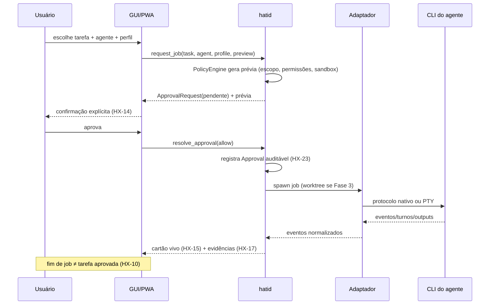
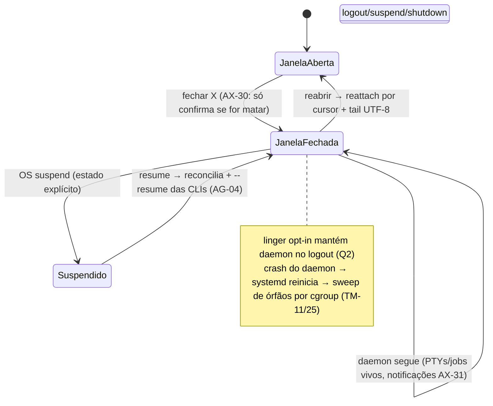

# Desenho arquitetural do HATI — PROPOSTA

> **Status: PROPOSTA (Prompt 03).** Este documento desenha a arquitetura recomendada a
> partir do `TECHNICAL_STUDY.md`. Nada aqui está aprovado; cada decisão material tem ADR
> proposto em `docs/decisions/proposals/`. Os requisitos R1–R14 de `docs/ARCHITECTURE.md`
> são o gabarito; a matriz de 187 IDs e as DT-01..DT-10 permanecem intocadas.

- **Data:** 15/10/2026 · **Autora:** Athena · **Dependências:** TECHNICAL_STUDY.md (Q1–Q14)

## 1. Visão geral — dois processos, um contrato

O HATI é **um serviço de execução supervisionado** (`hatid`, daemon Rust) com **clientes
reanexáveis** (GUI Tauri e, na Fase 5, PWA mobile). Toda a verdade viva — PTYs, jobs,
eventos, permissões, usage — vive no daemon. Os clientes renderizam e comandam; nada de
crítico morre com a janela (DT-05/R1).

## 2. Decisões estruturais (todas com ADR proposto)

| # | Decisão | ADR | Resumo da justificativa |
|---|---|---|---|
| D1 | Tauri 2 como shell; Electron plano B com critério objetivo | ADR-001 | Consumo/RAM, Rust compartilhado, distribuição Linux nativa (Q1) |
| D2 | Daemon `hatid` sob systemd `--user` com linger opt-in | ADR-002 | DT-05 por construção; journal/restart de graça; base do mobile (Q2) |
| D3 | SQLite WAL como espinha + arquivos de scrollback + JSON de preferências | ADR-003 | Transações n-n, Kanban auditável, backup consistente (Q3) |
| D4 | EventEnvelope append-only + SSE/WS + snapshots materializados | ADR-004 | Estado vivo de cartões, replay, sincronização de clientes (Q4) |
| D5 | Adaptadores com capacidades declaradas; PTY = fallback universal | ADR-005 | Paridade honesta (R6); eventos/permissões/custos reais (Q5) |
| D6 | PolicyEngine no daemon: JobGate + Git só-leitura p/ automação | ADR-006 | DT-04/HX-22 fora da UI; auditoria sem segredos (Q7) |
| D7 | Plugins: manifesto cedo; child webviews + sidecars na Fase 4 | ADR-007 | PL-02 (isolamento real); DT-08 (Q8) |
| D8 | Mobile = PWA do próprio daemon sobre TLS; Tailscale serve fora de casa | ADR-008 | RC-04 descartado; DT-09/DT-10 (Q9) |
| D9 | Usage local-first com consentimento default off | ADR-009 | US-04/US-09; estimativas marcadas (Q10) |
| D10 | Frontend React + TS + Zustand + xterm.js | ADR-010 | Ecossistema de terminal/dnd; contratos TS dos SDKs (Q1) |

## 3. hatid — subsistemas

### 3.1 Servidor IPC
- **Transporte:** Unix domain socket em `XDG_RUNTIME_DIR/hati/hatid.sock` (0700).
- **Autenticação:** peer credentials (`SO_PEERCRED`) + token por instância (para o gateway
  mobile). Nada escuta em rede sem TLS (Q9).
- **Superfície:** RPC tipado (JSON-RPC ou gRPC — fixar no ADR-002 na implementação) +
  **SSE/WS** de eventos com cursor por stream (Q4). A mesma superfície serve GUI e PWA;
  o RemoteGateway aplica ACL por dispositivo (RC-03).
- **Health:** `GET /healthz`-equivalente + status de versão de schema.

### 3.2 Executor de PTYs
- `portable-pty` (validada pela auditoria do Alethe; setsid no Linux) — cada PTY com:
  - **cgroup scope próprio** (`systemd-run --user --scope` + `hati.job.id`/`hati.pty.id`)
    para identidade comprovada e ceifa segura de órfãos (Q2/TM-11);
  - stream em lotes (16ms/64KB — padrão comprovado) para UI + scrollback;
  - scrollback append-only em `~/.local/share/hati/scrollback/<pty>.bin` com cap,
    compactação e **attach com tail 512KB alinhado a UTF-8** (TM-03/04);
  - estados explícitos: running/paused-read/suspended/exited(killed|failed|clean) e overlay
    de reinício (TM-17); resize com ResizeObserver na GUI (TM-06).
- Controles: write, resize, restart (mantém id — TM-07), kill de árvore gracioso
  (SIGTERM→prazo→SIGKILL; grupo via cgroup — TM-09), pause/resume de leitura (TM-14),
  gate de memória configurável no spawn (TM-12, não dogma).

### 3.3 Adaptadores de agentes (`AGENT_INTEGRATIONS.md`)
- **Registry** com capabilities por instância detectada (versão da CLI → faixas testadas).
- OpenCode: `opencode serve` dedicado por projeto + SSE + SDK; PTY TUI dirigível
  (`/tui/*`) para o interativo; eventos `session.idle/permission.asked/…` normalizados.
- Codex: `app-server` stdio/unix por sessão de trabalho; threads por cwd; steer/interrupt;
  `item/permissions/requestApproval` → fila de revisão do HATI (HX-19).
- Claude: SDK/headless stream-json para jobs; resume/fork; PTY TUI para o interativo.
- **Fallback universal:** qualquer agente custom = PTY puro (AG-01, extensível).

### 3.4 Barramento de eventos
- `EventEnvelope(id, stream, type, schema_version, payload, occurred_at, source,
  correlation_id)` append-only em `hati.db`; emissão **sanitizada** (sem segredos — HX-23);
  consumers por cursor; snapshots materializados em tabelas (Q4).

### 3.5 Store
- SQLite WAL via rusqlite; daemon é **o único escritor**; migrations versionadas no boot;
  backup online + export zip validado (Q3). Entidades em `DATA_MODEL.md`.

### 3.6 PolicyEngine
- **JobGate:** `Job` nasce em `pending_approval`; `spawn` só ocorre com `Approval` resolvido
  por humano (DT-04) — associação exata a job/escopo/permissões (HX-19).
- **Perfis de execução** (HX-05) + políticas por tarefa (HX-21) combinam com permission
  modes/sandbox da CLI; a decisão efetiva é exibida na prévia antes do spawn (HX-14).
- **Git:** para automação, apenas leitura (status/diff/log/list). Commit/push/merge = ações
  **humanas** com trilha; **inexistentes** no contrato mobile (HX-22/DT-06). O HATI
  declara explicitamente: agentes com shell livre podem contornar — guardas são
  facilitação; enforcement real vem dos permission modes/sandboxes das CLIs (AG-03).

### 3.7 WorktreeManager (Fase 3)
- `git worktree` via git2-rs/CLI: provision/list/lock/remove por job; **nunca descarta
  alterações sem revisão** (GT-05/OR-03); branch naming `hati/<task>/<job>`.

### 3.8 UsageService
- Providers plugáveis com capacidades (local/estimado/remoto-consentido); cache compartilhado
  com frescor/erros visíveis (US-06); consentimento default off (US-09) (Q10).

### 3.9 RemoteGateway (Fase 5)
- Serve a PWA estática + WS/SSE por TLS (LAN: cert próprio; fora de casa: `tailscale
  serve`); pareamento QR→token efêmero→dispositivo com escopos/expiração/revogação (RC-06);
  ACL por dispositivo sobre a mesma API do daemon (RC-03) — **nenhuma rota Git de escrita
  existe nesse contrato** (Q9).

### 3.10 PluginHost (Fase 4)
- Manifesto `hati-plugin.json` (capacidades/contribuições/versionamento — DT-08); UI em
  **child webviews** isoladas; backend em **sidecar** com API restrita; storage por plugin
  com quota (PL-05); temas sanitizados por tokens (PL-08) podem anteceder (Q8).

## 4. GUI (desktop) — estrutura de front-end

- **React + TS (Vite)** com **Zustand** (estado de UI, não-persistido) — o domínio vive no
  daemon; a GUI é cliente (cache + optimistic local limitado a pinturas, nunca a verdade).
- **xterm.js** (`@xterm/xterm` + fit/search/webgl/canvas — TM-21/16) por pane; sub-abas por
  agente/shell/cwd (TM-02); layouts Auto/Spotlight/Custom Grid com `react-resizable-panels`
  + dnd-kit (LY-01..06, WS-09).
- **i18n** pt-BR/EN com chaves validadas por build (`tsc` falha com chave faltando — AX-16,
  padrão comprovado); temas dark/Clean por tokens sanitizados (AX-14/15).
- **Painéis:** Projects Hub (HX-01/02), Kanban (HX-06..10 — fonte única de tarefas),
  Orchestration Board (**jobs**, nunca tarefas — OR-01/R8), Usage (US-*), Git pane
  (GT-01/02/03), Revisões (HX-19/20), Right sidebar contextual (AX-28).
- **Kanban ↔ execução:** mover cartão NUNCA spawna (DT-04); o cartão mostra estado vivo por
  eventos (HX-15) e oferta "iniciar execução" → prévia (HX-14) → JobGate.

### 4.1 Fluxo de autorização de job (DT-04)

### 4.2 Ciclo de vida da janela (DT-05)

## 5. Mapa de requisitos R1–R14 → subsistemas

| Req | Quem cumpre | Onde |
|---|---|---|
| R1 serviço independente | hatid + systemd --user + linger | §3.1/3.2, ADR-002 |
| R2 autorização no backend | PolicyEngine/JobGate + approvals | §3.6, ADR-006 |
| R3 Git fora da automação | GitService só-leitura + Git humano | §3.6, ADR-006 |
| R4 dados fora dos repos, segredos no keyring | XDG + keyring + sanitização | §3.5, ADR-003 |
| R5 Linux 1ª classe | CI Arch + e2e WebKitGTK/Hyprland | VALIDATION_PLAN §4 |
| R6 OpenCode 1ª classe + honestidade | Adaptadores + capabilities | §3.3, ADR-005 |
| R7 tarefa ≠ job, n-n | DATA_MODEL | ADR-003 |
| R8 Kanban única fonte; board = jobs | Store + GUI panels | §4, DATA_MODEL |
| R9 eventos confiáveis normalizados | Barramento + adaptadores | §3.3/3.4, ADR-004/005 |
| R10 extensibilidade cedo, core forte | Manifesto F1 + host F4 | §3.10, ADR-007 |
| R11 transporte protegido + pareamento | RemoteGateway + TLS | §3.9, ADR-008 |
| R12 i18n tipado | chaves validadas por build | §4 |
| R13 usage local-first | UsageService | §3.8, ADR-009 |
| R14 escrita segura em configs de CLIs | padrão MC-03: parse→guard→preview→backup→atomic write→self-check (a implementar na fase MC, herda invariantes da auditoria) | VALIDATION_PLAN §5 |

## 6. Fases de construção técnica (proposta — espelha Q13)

- **F0.5 (pós-aprovação dos ADRs):** PoCs 01/02/03/04/06 (+05/08 no início da F1).
- **F1 — Núcleo de execução:** hatid (IPC, PTYs, eventos, store mínimo) → GUI mínima
  (projetos por pasta, terminais, reattach) → 3 CLIs detetáveis + PTY + OpenCode server →
  e2e smoke em CI + empacotamento AppImage/AUR.
- **F2 — Kanban + usage local:** entidades tarefa/subtarefa/dependência, Kanban UI,
  JobGate com DT-04, eventos de progresso, usage OpenCode local + estimativas marcadas.
- **F3 — Jobs/worktrees/revisão:** worktrees por job, board de jobs, fila unificada de
  revisões, Git humano auditado, evidências com confiabilidade, sandbox de workers (PoC).
- **F4 — Extensibilidade:** PluginHost (child webviews/sidecars), MCP/skills management
  (invariantes de escrita segura), Graphify **fica de fora** (slot apenas — Q11).
- **F5 — iPhone:** RemoteGateway, PWA, pareamento/revogação, follow agents (RC-07).
- **F6 — Windows:** mesmo contrato; Job Objects/prioridade/WSL (TM-10/13/19/26 adiados).

**Dependências duras:** F1←(ADR-001/002/003/004/005/010 + PoCs) · F2←F1(eventos) ·
F3←F2(tarefa/job) · F4←F2(API cedo ok, runtime maduro) · F5←F1..3(núcleo confiável, DT-10).

## 7. Riscos estruturais e mitigações (top-5)

| Risco | Prob. | Impacto | Mitigação |
|---|---|---|---|
| Quirks WebKitGTK inviabilizam xterm/UX | Média | Alto | PoC-06 gate + ADR-001 plano B Electron com critério objetivo |
| Protocolos das CLIs mudam (OpenCode v2, Codex WS experimental) | Alta | Médio | capabilities + faixas testadas + schemas gerados + feature detection |
| Processos órfãos/morte suja no Linux | Média | Alto | cgroup scopes + sweep por identidade + e2e de logout/suspend (PoC-01) |
| Estado duplicado Kanban/board | Média | Alto | uma store + board derivado de jobs (R8); invariantes testados |
| Shell livre contorna guardas | Alta | Médio | declaração honesta na UI; enforcement real = permission modes/sandbox das CLIs; worktrees isolam escrita |

Próximos detalhes por domínio: `DATA_MODEL.md`, `AGENT_INTEGRATIONS.md`,
`SECURITY_AND_RUNTIME.md`, `VALIDATION_PLAN.md`.
